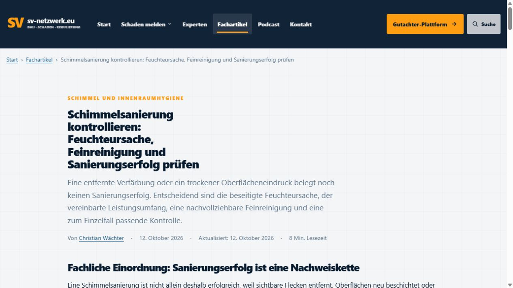
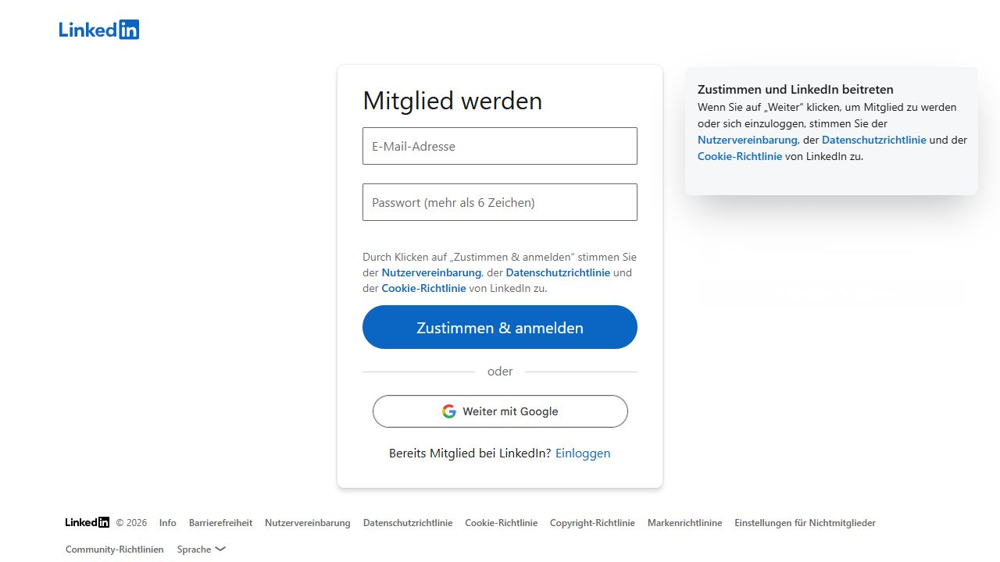

# LinkedIn-Veröffentlichungsnachweis 12.10.2026 – blockiert

Prüfzeit: 2026-10-12T07:06:32+02:00 (Europe/Berlin). Keine Veröffentlichung durch diesen Lauf. Keine LinkedIn-Reservierung, kein Upload, kein Absendeversuch und kein Permalink. Der tatsächliche öffentliche LinkedIn-Veröffentlichungsstand ist wegen der Anmeldesperre ungeklärt; `not-posted` im Register ist kein Beweis, dass kein manueller Beitrag existiert.

## Heutiger Websiteartikel

- Artikelkennung: `2026-10-12-schimmelsanierung-feuchteursache-feinreinigung-sanierungserfolg-pruefen`.
- Titel: Schimmelsanierung kontrollieren: Feuchteursache, Feinreinigung und Sanierungserfolg prüfen.
- Kanonische URL: https://www.sv-netzwerk.eu/fachwissen/schimmelsanierung-feuchteursache-feinreinigung-sanierungserfolg-pruefen/.
- Sichtbar im Codex-Browser geprüft: Fachwissen-Übersicht mit Datum 12.10.2026 sowie vollständige Detailseite, Titel, Autor Christian Wächter, Datum und interne Fachgebietszuordnung Carmen Gohl. Canonical aus dem aktuellen DOM geprüft.
- Profil https://www.sv-netzwerk.eu/experten/carmen-gohl/ sichtbar gelesen: Schimmelpilze in Gebäuden, Ursachen-/Schadensbewertung, Sanierungsplanung, Sanierungsbegleitung und Sanierungskontrolle. Zuordnung ist belegt; keine Autorenschaft Carmen Gohls behauptet.
- Ursprünglicher Artikelcommit: `32c70f67b513f8a5b3a02fa74080c38de1068f4f`.
- Endgültiger live ausgelieferter Websitecommit: `1fe12ec94df6cdef582fcfec6d594dc0a78a47be`, unter https://www.sv-netzwerk.eu/deploy-version.txt per HTTPS gelesen.
- https://github.com/Chris-GD13/sv-netzwerk/actions/runs/38203988621 sichtbar geöffnet: Status Success, Commit 1fe12ec, Job deploy erfolgreich.

## Konkreter LinkedIn-Blocker

Browserinventar und erneute Verbindungssuche bieten nur Codex In-app Browser und MCP Apps. Der direkte unterstützte Aufruf von Chrome für https://www.linkedin.com/in/christian-w-156408204/recent-activity/all/ scheitert mit „Browser is not available: chrome“. Die ersatzweise sichtbare Weboberfläche im Codex-Browser leitet zur LinkedIn-Anmeldesperre um. Keine Anmeldung vorgenommen und keine Sperre umgangen.

Damit fehlen die Live-Duplikatprüfung vor Erstellung, der Absendernachweis und der mögliche Veröffentlichungsablauf. Register und heutige CSV wurden gelesen; Register LinkedIn `not-posted`, CSV vorher `prepared-not-posted`. Kein finaler Begleittext erstellt, weil die vorgeschaltete Live-Duplikatprüfung nicht möglich ist. Die Quellenbelege des Website-Auftrags wurden gelesen; keine eigene Quellenrecherche oder Veröffentlichung eines LinkedIn-Textes als abgeschlossen ausgegeben.

Fortsetzung: Chrome-Profil Christian mit der unterstützten Browsersteuerung verbinden und LinkedIn angemeldet öffnen. Danach erneut heutigen Artikel, Register, CSV und jüngste persönliche Beiträge prüfen; einen tatsächlich vorhandenen Beitrag zuerst live klären. Erst nach erfolgreicher Duplikatprüfung atomar reservieren und gegebenenfalls genau einmal veröffentlichen.

## Verbindliche Bild- und Kostenentscheidung

Zusatzbudget 0 USD; tatsächliche zusätzliche Bildkosten dieses Laufs 0 USD. Kein Bildmodell, keine Bild-API, kein API-Schlüssel, keine zusätzlichen Credits oder Stockkäufe genutzt. Die konkrete Abrechnung eines enthaltenen Work-Bildwegs ist nicht verifiziert, daher wurde dieser Weg ohne Testaufruf übersprungen. Kein ausdrücklich freigegebener fachlich passender Bildbestand belegt. Für die Fortsetzung ist ein sachlicher Linkbeitrag ohne Bild vorgesehen; eine lokale Titelkarte wurde für diesen erklärenden Fachtext nicht als erforderlich angesehen. Tatsächlich wurde wegen des Browserblockers weder mit noch ohne Bild veröffentlicht. Kein Bildhinweis erfunden.

## Vorgaben und Git-Nachweis

Gelesen: Desktop-Anweisung; aktuelle einschlägige Drive-Dateien FACHBEITRAG_AUTOMATION.md (Stand 07.10.), FACHBEITRAG_STANDARD.md, linkedin-veroeffentlichung-2026-10-06.md und Master-Arbeitsstandards einschließlich „ab sofort immer gültig“; Repository AGENTS.md, DEPLOYMENT.md, Website-Workflow und beide angeforderten Veröffentlichungsdokumente. Die ausdrückliche Nutzerfreigabe und Kostenregel dieses Auftrags gehen älteren Bildpflichten und prepared-only-Regeln vor.

Git-Verwaltungsbasis mit origin https://github.com/Chris-GD13/sv-netzwerk.git verifiziert und origin/main frisch geholt. Verschmutzte Verwaltungsbasis nicht bearbeitet. Sauberer frischer Worktree aus `ec7b4492` verwendet. Nur Status-/Nachweisdokumentation mit [skip ci]; kein zusätzlicher Website-Deploy.

## Screenshots

