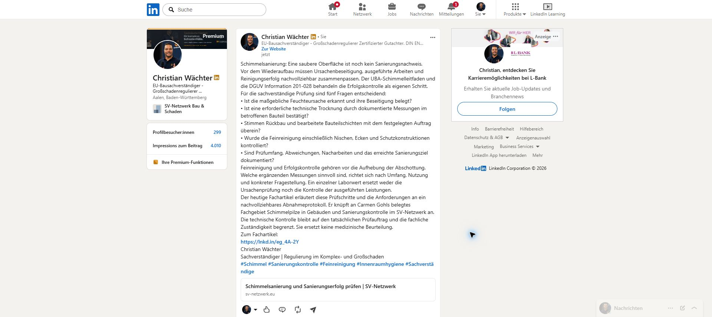

# LinkedIn-Veröffentlichung 12.10.2026 – published-verified

Genau einmal auf Christian Wächters persönlichem Profil veröffentlicht und am tatsächlichen Permalink sichtbar live geprüft:

https://www.linkedin.com/feed/update/urn:li:activity:7515294243175936000/

Live verifiziert: **2026-10-12T08:17:53+02:00 (Europe/Berlin)**. Veröffentlichung nach atomarer Reservierung um 2026-10-12T08:13:09+02:00 und vor 08:17:50 Europe/Berlin; ein sekundengenauer Absendezeitpunkt wurde nicht separat erfasst. Ein einziger Klick auf Posten, anschließend LinkedIn-Erfolgsmeldung „Der Beitrag wurde gepostet“, Profil neu geladen und Permalink geöffnet. Keine Wiederholung des Absendevorgangs.

## Artikel, Thema und Fachgebietszuordnung

- Artikelkennung: `2026-10-12-schimmelsanierung-feuchteursache-feinreinigung-sanierungserfolg-pruefen`.
- Titel: Schimmelsanierung kontrollieren: Feuchteursache, Feinreinigung und Sanierungserfolg prüfen.
- Artikel: https://www.sv-netzwerk.eu/fachwissen/schimmelsanierung-feuchteursache-feinreinigung-sanierungserfolg-pruefen/.
- Heutiges Datum 12.10.2026, vollständiger Inhalt, Canonical und Übersicht im vorangegangenen Lauf geprüft; Detailseite vor Veröffentlichung nochmals im angemeldeten Chrome-Browser gelesen.
- Eigenständiges Sachverständigenthema, kein künstlicher Versicherungsfall. Fachliche Zuordnung Carmen Gohl; aktuelles Profil belegt Schimmelpilze in Gebäuden und Sanierungskontrolle. Keine Autorenschaft Carmen Gohls behauptet.
- Endgültiger Websitecommit `1fe12ec94df6cdef582fcfec6d594dc0a78a47be` live erneut per deploy-version.txt bestätigt. Zugehöriger erfolgreicher Website-Run: https://github.com/Chris-GD13/sv-netzwerk/actions/runs/38203988621 . Sichtbare Success-Prüfung im vorherigen Lauf dieses Chats.

## Duplikatkontrolle und Reservierung

Chrome-Profil Christian war nach dem Nutzerhinweis verbunden und LinkedIn angemeldet. Persönliche Aktivitäten unter https://www.linkedin.com/in/christian-w-156408204/recent-activity/all/ vor Erstellung sowie unmittelbar vor Absenden neu geladen. Letzter eigener Fachbeitrag: gestriger Schallschutzartikel mit Aktivität 7514992211571331072. Kein heutiger Beitrag zur Sanierungskontrolle vorhanden. Älterer Beitrag vom 30.09. zu Schimmel nach Wasserschäden ist ein anderer Artikel.

Tagesregister und heutige CSV-Hauptzeile vor Erstellung und unmittelbar vor Absenden geprüft. Eigene atomare Reservierung per publication-day-guard.mjs claim-linkedin: `64b523640d6665169ecd0554078218e89b365ccc`; Owner `codex-linkedin-20261012-01a12e7c-resumed`. Keine fremde Reservierung übergangen. Live-Verifikation per verify-linkedin erst nach sichtbarem Permalink-/Text-/Linknachweis: `32045b704b2d8ed937e030a60871aaae4bed9636`.

## Sichtbarer Veröffentlichungsnachweis

Am tatsächlichen Permalink geprüft: Absender Christian Wächter, vollständiger Text mit fünf Prüffragen, Carmen-Gohl-Fachgebietsbezug, Rollenbezeichnung, eigener Hashtagabsatz und Artikelvorschau. Keine Bilddatei hochgeladen und kein Bildhinweis erfunden. Der sichtbare Kurzlink https://lnkd.in/eg_4A-2Y wurde im Browser bis zum korrekten kanonischen Tagesartikel verfolgt; dessen h1 und Canonical stimmen überein.

## Fach- und Kostenprüfung

UBA-Schimmelleitfaden April 2024 und DGUV Information 201-028 November 2022 vor Texterstellung tatsächlich geöffnet und die für die Aussagen benötigten Abschnitte gelesen. Abrufdatum 12.10.2026 und Aussagenzuordnung in [Quellenprüfung](linkedin/2026-10-12/2026-10-12-linkedin-quellenpruefung.md). Keine erfundenen Fälle, Messwerte, Normgrenzwerte oder Zusicherungen. Keine aus einem nicht eingesehenen Normvolltext übernommenen Detailanforderungen.

Zusatzbudget **0 USD**, tatsächliche zusätzliche Bildkosten **0 USD**. Veröffentlichung **ohne Bild**. Konkrete Abrechnung eines enthaltenen Work-Bildwegs nicht verifizierbar; dieser Weg wurde ohne Testaufruf übersprungen. Kein ausdrücklich freigegebener fachlich passender Bildbestand belegt. Die fachliche Prüfliste ist ohne zusätzliche lokale Titelkarte sinnvoll. Kein Bildmodell, keine Bild-API, kein Bildschlüssel, keine Credits und keine Stockkäufe verwendet.

## Artefakte und Status

- [Tatsächlich veröffentlichter Text](linkedin/2026-10-12/2026-10-12-schimmelsanierung-linkedin.txt).
- [Quellenprüfung](linkedin/2026-10-12/2026-10-12-linkedin-quellenpruefung.md).
- [Duplikatprüfung vor Erstellung](linkedin/2026-10-12/2026-10-12-duplikatpruefung-vorher.jpg).
- [Beitragsvorschau](linkedin/2026-10-12/2026-10-12-linkedin-vorschau.jpg).

Register und heutige CSV-Hauptzeile stehen auf published-verified mit echtem Permalink und Berliner Verifikationszeit. Die Bildentscheidung ist in beiden Nachweisen dokumentiert. Nur Status-/Nachweisdokumentation mit [skip ci]; kein zusätzlicher Website-Deploy. Verschmutzte Git-Verwaltungsbasis nicht bearbeitet; sauberer Worktree und normale Push-Prüfung ohne force verwendet.

## Frühere Sperre – behoben

Der frühere Lauf um 07:06 Europe/Berlin war wegen fehlender Chrome-Verbindung blockiert und führte keinen Absendeversuch aus. Historischer Nachweiscommit: `d12f2e40bf409847f2234fe241fbe71026750c32`. Nach Nutzerhinweisen „ist im Tab geöffnet“ und „ohne weitere nachfrage veröffentlichen“ bestand die verbundene angemeldete Chrome-Sitzung Christian. Die Veröffentlichung wurde mit erneuter Live-Duplikatprüfung fortgesetzt. Der frühere Blocker ist erledigt; diesen Tagesbeitrag nicht erneut senden.
